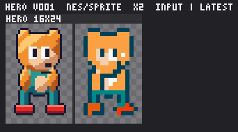
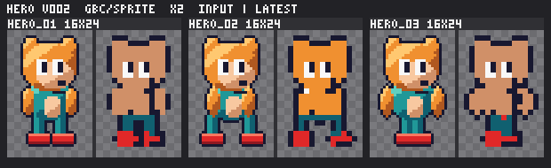

# AgentSprite (`pxl`)

`pxl` turns high-resolution art into **pixel art for real retro hardware**: sprites, tiles and screens that stay as close to your source as the
target resolution allows, read clearly at 1x, and obey the console's limits exactly (palettes, colours per cell, sprites per line, tile budgets,
colour format). It is one command-line tool for people and for AI agents. The tool gives fast views, cheap edits and hard hardware limits; the
agent skills in this repository carry the craft (hand-finishing, review, leading a whole project). Nine consoles are built in, from the Game Boy to
the Game Boy Advance. It ships no game data and reads PNG images only.

## For agents: start here

1. **Install `pxl`** (one of):
   ```
   curl -fsSL https://raw.githubusercontent.com/kkollsga/agentsprite/main/install.sh | sh
   ```
   macOS and Linux. It verifies the sha256, installs to `~/.local/bin` (or `$PXL_INSTALL_DIR`), prints a PATH hint if needed, and runs
   `pxl skill install` (opt out: `sh -s -- --no-skills` or `PXL_INSTALL_SKILLS=0`; a version: `sh -s -- --version v0.1.0`).
   Windows PowerShell:
   ```
   irm https://raw.githubusercontent.com/kkollsga/agentsprite/main/install.ps1 | iex
   ```
   Manual: download `pxl-<tag>-<target>.tar.gz` (`.zip` on Windows) and its `.sha256` from
   [Releases](https://github.com/kkollsga/agentsprite/releases), check the sum, put `pxl` on your PATH. Targets: `x86_64-unknown-linux-musl`,
   `aarch64-unknown-linux-musl`, `x86_64-apple-darwin`, `aarch64-apple-darwin`, `x86_64-pc-windows-msvc`.
   Fallback, from a clone (Rust stable): `cargo build --release`, then use `target/release/pxl`.
2. **Install the skills** (skip if the installer already did): `pxl skill install`. It writes the six skills to `~/.claude/skills/` and
   `~/.codex/skills/` (`--host claude` or `--host codex` for one, `--project` for `./.claude/skills` instead of the home folder, `--dry-run` to preview).
   Re-run it after upgrading `pxl`; every installed `SKILL.md` carries the version that wrote it, and `pxl skill path` says whether they are current.
3. **Verify:** `pxl --version` and `pxl console list`.
4. **Learn the tool:** `pxl guide` (single image) and `pxl guide project` (projects).
5. **Load the `pxl-operator` skill first** when you lead a job from a request to a delivery, then the others as the work needs them (table below).
   Without installed skills you can read them from the binary: `pxl skill show pxl-operator`.

## Skills

Plain-text Agent Skills (a `SKILL.md` plus `references/`), in `skills/`. `pxl skill list` prints them with their descriptions, `pxl skill show NAME
[--ref FILE]` prints one.

| Skill | Use it when | What it gives |
|---|---|---|
| `pxl-operator` | you lead a project: someone gives you images and a goal, or you plan, run intake, style frames, delivery, decisions or reports | infer, assume and show; ask only what cannot be inferred; the order of a run; client engine model; reports |
| `pxl-extract` | the user has game data (a ROM they provide, a disassembly, rips, emulator dumps) rather than ready images | getting graphics into the PNG inbox contract, QA, legal note |
| `pxl-sprite` | you draw: convert or hand-finish sprite frames; a frame lost its eyes, face or key colours | the artist's rules and loop, fast `pxl` use, self-review |
| `pxl-tiles` | you hand-finish tile sets or screens; tiles blur or break at edges; textures must repeat | tile workflow, textures as repeating units, tile limits |
| `pxl-review` | you judge finished parts and approve or send them back | review packet, checklist, actionable rework notes |
| `pxl-coordinate` | several agents work in parallel | claims and leases, templates, palettes, snippets, tasks, briefs |

How to get them, in order of preference:

- **Installed skills:** `pxl skill install` (above). Your agent host loads them by name.
- **Claude Code plugin:** this repository is also a plugin and its own marketplace. In a session: `/plugin marketplace add kkollsga/agentsprite`, then
  `/plugin install agentsprite@agentsprite` (skills appear as `/agentsprite:pxl-operator`). On the command line: `claude plugin marketplace add
  kkollsga/agentsprite` and `claude plugin install agentsprite@agentsprite`. Try without installing: `claude --plugin-dir ./agentsprite`.
- **Read the files:** `skills/<name>/SKILL.md` and `skills/<name>/references/*` in a clone, or `pxl skill show <name>`.

`pxl skill uninstall` removes what `pxl skill install` wrote. Both only touch folders that carry a `.agentsprite-managed` marker; a skill folder you
made yourself is never replaced or removed.

## The model

```
console  ->  mode (sprite | tile | screen)  ->  one image  or  a project
```

- **Console:** hardware facts as data (`consoles/<id>/`): screen, colour format, palette layout, sprite limits, with the primary reference each comes
  from. `pxl console list | show [ID] | set ID`. A project may override any of it.
- **Mode:** `sprite` (objects with cells and palette slots), `tile` (unique tiles, tile palettes, repeating textures) or `screen` (a whole image
  against the tile budget). `--mode` on `pxl image` and `pxl ingest`.
- **Single image:** no project. `pxl image hero.png --console nes --mode sprite --factor 2` makes `hero.pxl/` beside the picture with the input, a first
  reduction, versions and `compare.png`. Every command then takes that folder.
- **Project:** a managed folder for many assets with inputs, every version, compare images, work lists, review gates, a plan before pixels, a design
  language and a machine-readable delivery.

`--factor N` says the picture is drawn at N times the target resolution (a 32x48 picture with `--factor 2` becomes a 16x24 sprite).

| Console | Id | Screen | Colour | Sprites |
|---|---|---|---|---|
| Game Boy | `gb` | 160x144 | 4 fixed shades | 40 per frame, 10 per line, 8x8 or 8x16 |
| Game Boy Color | `gbc` | 160x144 | RGB555, 8 OBJ + 8 BG palettes of 4 | 40 per frame, 10 per line, 8x16 cells |
| Nintendo Entertainment System | `nes` | 256x240 | fixed 2C02 palette, 4 + 4 palettes of 4 | 64 per frame, 8 per line |
| Sega Master System | `sms` | 256x192 | 64 colours, 2 palettes of 16 | 64 per frame, 8 per line |
| Sega Game Gear | `gg` | 160x144 | 4096 colours, 2 palettes of 16 | 64 per frame, 8 per line |
| Sega Mega Drive | `md` | 320x224 | 512 colours, 4 lines of 16 | 80 per frame, 20 per line, 1x1 to 4x4 tiles |
| Super Nintendo | `snes` | 256x224 | 15-bit, 8 sprite palettes of 16 | 128 per frame, 32 per line |
| PC Engine | `pce` | 256x224 | 9-bit, 16 + 16 palettes of 16 | 64 per frame, 16 per line |
| Game Boy Advance | `gba` | 240x160 | 15-bit, 16 palettes of 16 (or 256) | 128 OBJs, 12 shapes |

The limits are per zone or screen and shared by everything shown together; `pxl console show ID` has every number per mode. Each console also carries
`[style]` defaults for the design language (on the classic Game Boy white is a main tone because there are only three sprite shades; elsewhere it is for
highlights and eye whites).

## Single image, in four commands

```
pxl image hero.png --console nes --mode sprite --factor 2
pxl lint hero.pxl --rules eye_parity,identity_colour,flat
pxl show hero.pxl hero --ref
pxl export hero.pxl
```

The automatic reduction is a rough sketch: `lint` says what to fix (limits are errors, looks are warnings), `show --ref` prints the frame and the source
as letters to copy and edit, `export` writes console-format files to `hero.pxl/export/`. Open `hero.pxl/compare.png`: input | latest, regenerated every
time the asset is stored.

## The operator workflow

The order a project runs in. `pxl-operator` and its `references/playbook.md` hold the judgement; these are the commands.

1. **Intake.** Learn the target (console, modes, the client's spec and checker), then bring the pictures in.
   ```
   pxl new game --console gbc --name Game && cd game
   cp -R ../inputs/hero inbox/ && pxl ingest inbox/hero --group player --factor 2
   pxl intake --request "Demo for the Game Boy Color, faithful to the source"
   pxl qa
   ```
   `pxl ingest` turns numbered pictures (`hero_01.png`, `hero_02.png`) into one asset of frames (`--separate` opts out; `--mode tile|screen`,
   `--grid 32x32`, `--frames auto` for sheets). `pxl intake` infers console, modes, fidelity, an identity list (eyes, key colours, materials), cadence and
   trade-off policy into `brief.toml`; each item is a reversible assumption in `decisions.md` (`pxl decide "why" --set fidelity=reinterpreted --by user`).
   `pxl qa` flags noisy sources, borrowed art and unused frames as question tasks.
2. **Style and design language.**
   ```
   pxl style analyze
   pxl style propose
   ```
   `style.md` states outline, eyes, identity colours, ramps, light, white, highlight, dither, fold and readability, with what each console limit does
   to this input. `pxl style show` prints it; `pxl style identity ASSET show|add|remove|set` edits the colour list the gates use.
3. **Plan before pixels.**
   ```
   pxl plan
   pxl plan --apply
   pxl palette plan main
   pxl budget main --what-if "remove hero"
   pxl plan accept
   ```
   Scenes, VRAM fit, group budgets and a shared palette are decided before anyone draws; infeasible scenes come with options. `pxl plan accept` records the
   sign-off as `agent` (`--by user` only when the user said so).
4. **Style frames.** Three to six key assets drawn to final quality first, so the user corrects the look early.
   ```
   pxl style mark hero
   pxl style approve
   pxl deliver --dry-run
   pxl milestone status
   ```
   Production work is handed out only after: plan accepted, style approved, dry run passed.
5. **Work list.** Hand-finishing is the agents' job (`pxl-sprite`, `pxl-tiles`).
   ```
   pxl task add hero "fix the eyes" --kind fix
   pxl next --agent artist1
   pxl brief hero
   pxl board
   ```
   `pxl next` claims the next part; `pxl brief` gives a fresh agent decisions, tasks, review history, budgets and paths. Edit with `pxl set`, `pxl row`,
   `pxl patch`, `pxl fill`, `pxl stamp`, `pxl fix`, `pxl view`, `pxl undo` (`pxl --help` lists them all).
6. **Review gates.**
   ```
   pxl lint hero
   pxl review next
   pxl review checklist hero
   pxl review note hero hero_01 "left eye lost" --region 8,4,3,3 --rule eyes --agent reviewer
   pxl review approve hero --agent reviewer --justify "why the warnings are acceptable"
   pxl rework hero --note "restore the pupils"
   ```
   The gates (`eye_parity`, `identity_colour`, `flat`, `consistency`, `readability`) block approval unless justified. `pxl report` digests done work, new
   images, pending decisions with recommendations, budgets and milestones for the user (`--html` for a page).
7. **Deliver.**
   ```
   pxl build
   pxl check
   pxl deliver
   pxl changes --since 1
   ```
   `build` writes console-format files and `export/manifest.json`; `check` lints everything and compares the exact output files; `deliver` runs those
   checks, the package verifier and the client's checker (`--client-checker CMD`) and snapshots to `deliveries/N/`.

Questions to the user are asked rarely and as options with an image each and a recommendation:
`pxl ask "topic" --option A=img.png|label --option B=img.png --recommend A "why"`, then `pxl decisions`.

## Reference

### Project folder

```
game/
  pxl.toml  pxl.toml.lock   the manifest: console, parts, scenes, palettes, delivery settings
  brief.toml  decisions.md  intake result and every decision and assumption
  style.md  style.toml      the design language
  plan.toml                 the accepted plan
  inbox/                    you drop PNGs here
  assets/<group>/<name>/    asset.pxl, input/, versions/, compare.png, compare.html, template.toml, palettes/
  palettes/  templates/  consoles/   shared palette sets, colour templates, console overrides
  export/                   console-format files and manifest.json (rebuilt by pxl build)
  review/                   review sheets and reports
  deliveries/N/             snapshots made by pxl deliver
  .pxl/                     internal state
```

### Never hand-edit; use the command

| Instead of editing | Use |
|---|---|
| scenes and budgets in `pxl.toml` | `pxl scene set`, `pxl scene add-part`, `pxl scene remove-part` |
| palette slots | `pxl palette slot set SET SLOT #rrggbb ...`, `pxl palette slot remove SET SLOT` |
| an asset's category | `pxl asset set ASSET category player` |
| project defaults and settings | `pxl project set defaults.category enemy`, `pxl project set settings.KEY VALUE` |
| the identity colour list | `pxl style identity ASSET add #rrggbb`, `remove`, `set` |
| decisions and assumptions | `pxl decide "why" --set key=value --by user` |
| facts no pixel holds (collision, repeat, frame semantics) | `pxl meta ASSET set collision 48x8`, `pxl meta ASSET frame NAME dropped true --reason WHY` |
| `versions/`, `compare.png`, `export/` | written for you; `pxl versions ASSET`, `pxl revert ASSET v003`, `pxl build` |
| an old project layout | `pxl migrate --dry-run` |

An asset the user approved personally is changed only with `--force-user-approved`.

### Compare images and versions

Every write of an asset stores a version: `assets/<group>/<name>/versions/<name>_vNNN.png` (a sheet of all frames) and `.pxl`. `compare.png` next to
`asset.pxl` is input | latest and is regenerated on every store (`compare.html` is the same page as HTML). In a single-image
folder the same files sit in `NAME.pxl/`. `pxl versions ASSET` lists them, `pxl revert ASSET v003` restores one as a new version, `pxl diff` compares two,
`--no-version` skips storing for bulk work. A gate or compare without its source image says `reference_missing` (part and frame), and `pxl check` ends with
"checked N of M" so nothing is skipped silently.

### Image input contract

- Inputs are **PNG images**. Transparency is alpha; colours are the source colours, never pre-quantised or dithered.
- One folder per object, frames numbered in original order (`hero_01.png`, `hero_02.png`), the same canvas and origin for every frame, no scaling baked
  in (an unavoidable integer upscale is declared with `--factor`).
- Optional beside the frames: `palette.png`, `source.json` (copied to the asset's `input/`, read by `pxl qa`), `contact.png`.
- Game data (a ROM you provide, a disassembly, rips, emulator dumps) is not read by `pxl`. The `pxl-extract` skill covers turning it into this contract
  and the legal side.

### Machine-readable output

`--json` prints exactly one JSON object on stdout (errors too, exit code 2 for usage errors); `--agent NAME` identifies you for leases.

## Examples

`examples/` holds original CC0 art made for this project (generated by `examples/gen_inputs.rs`): a character in three poses with eyes and an identity
colour, a small enemy, an item, a 32x32 tile region and a title screen for every console size, drawn at 2x the target resolution.

```
examples/single/run.sh gbc     # the single-image demo
examples/project/run.sh nes    # new, ingest, intake, style, plan, build, deliver --dry-run
```

Both need `pxl` on PATH (or `PXL=path/to/pxl`) and work in a temp folder; any console id works. The first automatic reduction is the starting point, not the
result. Left to right below: the input, then the first reduction of the hero on the NES and on the Game Boy Color. The lost eyes are
exactly what `pxl lint --rules eye_parity,identity_colour` reports and what the skills teach an agent to restore by hand.




## Building from source

```
cargo build --release          # target/release/pxl, Rust stable
cargo test -- --test-threads=2
```

`build.rs` embeds `skills/` in the binary, so `pxl skill install` needs nothing else. Releases are built by `.github/workflows/release.yml` on a `v*` tag
(Linux musl x86_64 and aarch64, macOS x86_64 and aarch64, Windows x86_64) and the gates in `scripts/release_gates.sh`; `CHANGELOG.md` holds the notes.
`DESIGN.md` has the design command by command; `skills/README.md` the skills.

## Issues and Licence

Report bugs and requests at <https://github.com/kkollsga/agentsprite/issues>: include `pxl --version`, the console, the command you ran and, for a look
problem, the `compare.png`.

`pxl` is released under the MIT licence (`LICENSE`). The examples in `examples/` are CC0 (`examples/LICENSE`).

`pxl` reads and writes graphics and ships no game data. **Only process material you have the right to use**: your own art, material you are licensed to use,
or data you are legally allowed to study or port. Extracting graphics from a ROM or a commercial game is your responsibility; do not publish extracted or
derived third-party art.
